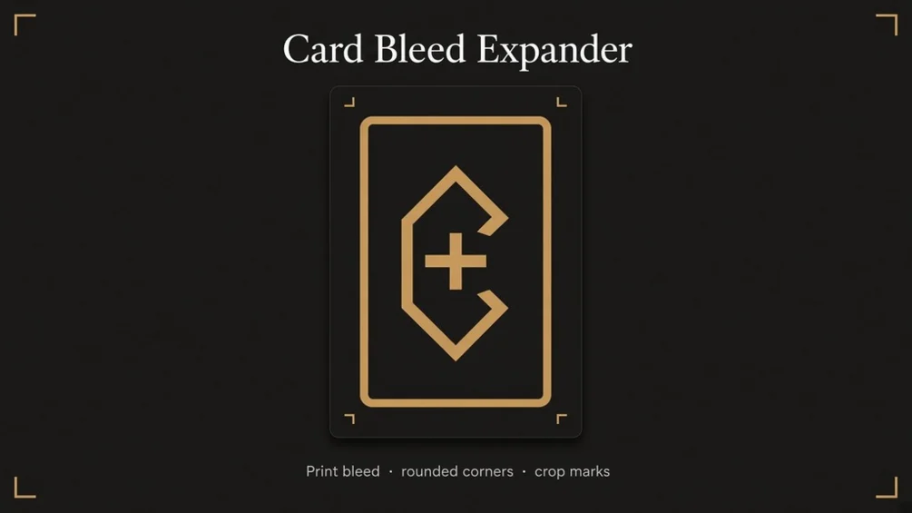
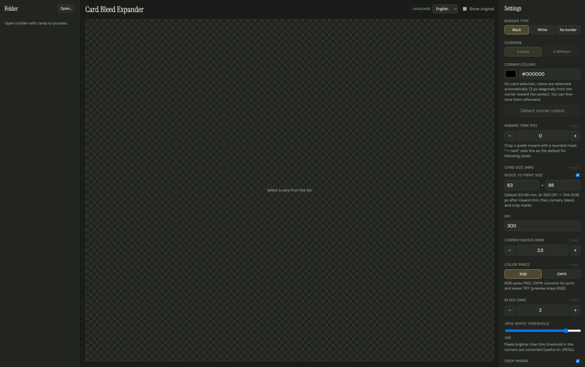

# Card Bleed Expander

<p align="center">
  
</p>

**Get your playing cards print-ready in a few clicks.**

[](https://ko-fi.com/M5Y42735ZD)

Card Bleed Expander is a desktop app (Mac & Windows) for full-art cards, board games, and custom decks. It takes your images, scales them to the correct physical size, adds print bleed, cleans up rounded corners, and generates crop marks — one card at a time or in batch.

Perfect when your PNG/JPEG art looks great but isn’t ready for a print shop or print-on-demand workflow yet.

**TL;DR:** From a folder of card art to trim-ready print files — size, bleed, corners, and crop marks, without opening Photoshop.

<p align="center">
  
</p>

---

## What it solves

Printing cards isn’t just about a nice image. You also need:

- the correct physical size (e.g. 63×88 mm at 300 DPI)
- a bleed margin beyond the trim line
- consistent corners (no white gaps or messy rounded edges)
- crop marks for cutting

Card Bleed Expander does exactly that, fully offline on your computer — no cloud uploads, no online queues.

---

## Key features

### Folder workflow (bulk load, card-by-card processing)

- Open a folder of cards (PNG, JPG, JPEG, WEBP)
- Browse with the side list or keyboard shortcuts
- Each card keeps its own settings; save and move to the next
- Clear status: **to do** / **saved**

### Automatic print sizing

- Resize to your chosen size (default **63×88 mm**)
- Configurable DPI (default **300**)
- After the inward trim, the card stays exactly at the chosen size
- Landscape sources are auto-swapped to match orientation

### Inward trim (edge cleanup)

- Cut *n* pixels inward with a rounded mask
- Great for removing imperfect borders, white fringing, or JPEG artifacts
- `+` / `−` steppers plus `Shift+→` / `Shift+←` shortcuts

### Print bleed

- Extends edges by copying outermost pixels (edge extend)
- Ideal for full-art cards: continuous edge colors instead of flat fills
- Bleed in mm, fully adjustable

### Rounded-corner fixing

- Border modes: **Black** / **White** / **No border**
- Corner colors: **4 same** or **4 different** (per-corner color pickers)
- Auto-detects color near each corner (3 px diagonally toward the center)
- JPEG white-threshold cleanup for non-transparent files
- Resample colors anytime (button or `Shift+C`)

### Smart crop marks

- Marks at trim corners, outside the card area
- High-contrast color vs each corner (dark corner → white marks, and vice versa)

### RGB or CMYK

- **RGB** → export PNG
- **CMYK** → convert and export TIFF for press workflows
- On-screen preview stays RGB (as it should)

### Defaults for following cards

- For trim, size, radius, bleed (and color space): **→ next** button
- Sets the current value as default for all following cards
- Or apply all defaults forward / apply to the whole folder

### Flexible saving

- **Save**
- **Save & next**
- **Save all** (full batch)
- Output goes to an `output/` folder next to your source images

<p align="center">
  
</p>

---

## Keyboard shortcuts

| Shortcut | Action |
|---|---|
| `←` `↑` `↓` `→` | Previous / next card |
| `Enter` | Save & next |
| `Shift+Enter` | Save all |
| `Shift+←` / `Shift+→` | Decrease / increase inward trim |
| `1` | One color for all corners |
| `2` | Four different corner colors |
| `Shift+C` | Resample corner colors |

---

## Who it’s for

- Card game and board game creators
- Anyone preparing files for printers or POD services
- Custom / full-art deck makers who want a repeatable pipeline
- People who want a local, focused tool — not a general-purpose image editor

---

## What you get

- Card Bleed Expander desktop app
- Builds for macOS and/or Windows (depending on the package you buy)
- Minor updates for the included version (if offered)

---

## Requirements (end users)

- macOS (Apple Silicon or Intel) or Windows 10/11 64-bit
- No internet required to process cards

### Good to know

- On Mac, Gatekeeper may ask for confirmation on first launch (unsigned app): right-click → **Open**
- On Windows, SmartScreen may show a similar first-run warning
- Everything stays on your machine: images are not uploaded to external servers
- **7 languages** available: EN, IT, FR, ES, DE, RU, 中文

---

## Quick start (app)

1. **Open…** a folder of cards
2. Adjust border/corners, inward trim, size (63×88), bleed, RGB/CMYK
3. **Save** / **Save & next** / **Save all** (`Shift+Enter`)
4. Find output in `output/` next to the source folder (PNG or CMYK TIFF)

---

## Development

### Requirements

- Node.js 20+
- macOS (to build Mac packages as well)

### Run in development

```bash
npm install
npm run dev
```

> If Electron doesn’t start and you see errors about `app.whenReady`, make sure `ELECTRON_RUN_AS_NODE` is not set (the `dev` script already clears it).

### Package for distribution

Prepare typecheck + build + native sharp binaries (Mac arm64/x64 + Windows x64):

```bash
npm install
npm run pack
```

This produces:

- `dist/` (UI)
- `dist-electron/` (main/preload)
- `@img/sharp-*` modules for Mac and Windows under `node_modules`

Then create installers:

```bash
# Mac only
npm run dist:mac

# Windows only
npm run dist:win

# Both
npm run dist
```

Artifacts land in `release/` (current version **1.1.0**):

| Platform | Typical files |
|---|---|
| Mac Apple Silicon | `Card Bleed Expander-1.1.0-arm64.dmg` |
| Mac Intel | `Card Bleed Expander-1.1.0.dmg` |
| Windows installer | `Card Bleed Expander Setup 1.1.0.exe` |
| Windows portable | `Card Bleed Expander 1.1.0.exe` |

### Packaging notes

- The `sharp:platforms` script is required before Windows/Mac cross-builds: otherwise Darwin binaries remain and the app won’t process images on PC.
- On Mac, Gatekeeper may warn on first launch (unsigned app). Right-click → **Open**, or:
  ```bash
  xattr -cr "/Applications/Card Bleed Expander.app"
  ```
- On Windows, SmartScreen may show a warning until the exe is signed.

---

[](https://ko-fi.com/M5Y42735ZD)
