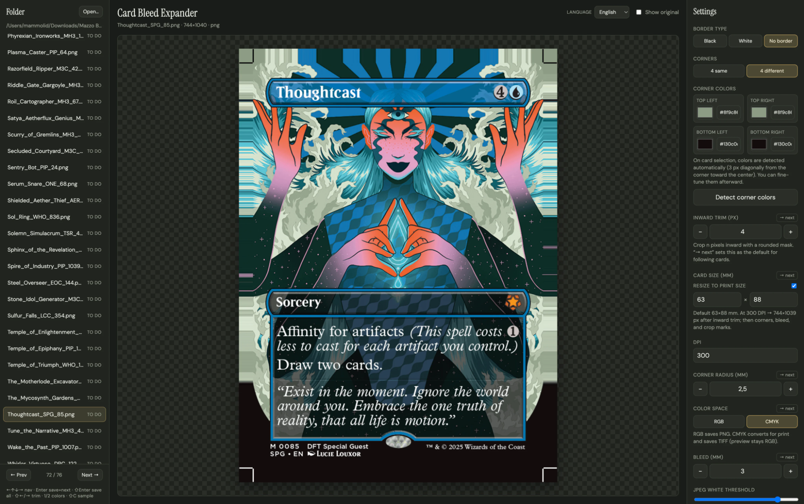
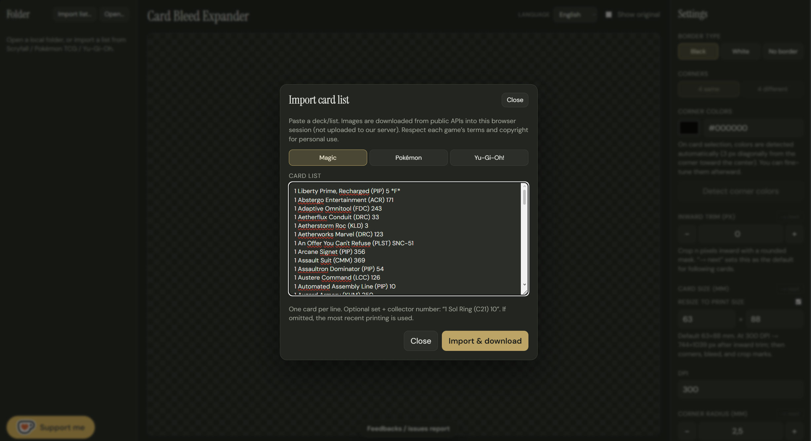

# Card Bleed Expander

**Print-ready playing cards in one click: bleed, rounded corners and crop marks, all in your browser.**

[**Try it live →**](https://card-bleed-expander.vercel.app) · Free · No account · Your images never leave your device



---

## Why I built it

My partner and I print cards for tabletop games at home. Card images rarely include **bleed**, the extra margin a printer needs so nothing gets cut off, so every card had to be fixed by hand in an image editor. Finding the images in the first place was just as slow.

This tool removes both steps: paste a deck list, download the images, and export print-ready files for the whole deck in one go.

## Features

- **Automatic bleed** for any card image, at the standard 63 × 88 mm size
- **Rounded-corner fill**, so scans with transparent or white corners print cleanly
- **Crop marks**, trim and border adjustments
- **RGB or CMYK** output for home or professional printing
- **Batch processing**: open a whole folder, then *Save*, *Save & next* or *Save all*
- **Deck-list import** for Magic: The Gathering, Pokémon and Yu-Gi-Oh!, using public card databases
- **Private feedback form** built into the app



## How it works

The image pipeline runs entirely client-side on an HTML Canvas.

1. **Edges.** The outermost row and column of pixels are repeated outwards to the required bleed width. Card borders are usually flat colour, so this is invisible once trimmed.
2. **Corners.** Rounded corners would leave white gaps. For each corner, the tool samples colour along the diagonal towards the centre of the card and fills the corner from those samples.
3. **Output.** The result is exported at print size, optionally with crop marks and converted to CMYK.

A deterministic approach was a deliberate choice over AI in-painting: it is instant, predictable and works offline.

## Privacy

Card processing is 100% local once images are on your device. The app only makes network requests:

- to the card databases ([Scryfall](https://scryfall.com/docs/api), [Pokémon TCG API](https://pokemontcg.io), [YGOPRODeck](https://ygoprodeck.com/api-guide/)) when you import a list; images are downloaded into the browser, never uploaded;
- to `/api/feedback` when you send feedback (message only; the recipient address stays on the server).

## Usage

1. **Open…** a folder of cards (Chrome and Edge use the directory picker; other browsers fall back to a file dialog), or **Import list…** to paste a deck list
2. Adjust border, corners, trim, size, bleed and colour mode
3. Pan and zoom the preview: scroll, drag or `+` / `−`; double-click to reset
4. Optionally **Choose save folder** (Chromium); otherwise files go to Downloads
5. **Save**, **Save & next** or **Save all**

## Tech stack

- React + Vite
- Client-side image pipeline (Canvas)
- Vercel: static hosting, serverless `/api/feedback`, Vercel Analytics
- Nodemailer over Gmail SMTP for the feedback form

## Run it locally

Requires Node.js 20+.

```bash
npm install
npm run dev
```

Build with `npm run build` (output in `dist/`), preview with `npm run preview`.
For the feedback API locally, use `vercel dev` with the environment variables below.

### Environment variables (feedback form only)

| Name | Purpose |
|---|---|
| `GMAIL_USER` | Gmail address used to send mail (SMTP login) |
| `GMAIL_APP_PASSWORD` | [Google App Password](https://myaccount.google.com/apppasswords) for that account (requires 2FA) |

Add them in Vercel under **Project → Settings → Environment Variables**. They are never shipped to the browser.

## Desktop app (Windows)

A Windows installer is available on the [Releases](https://github.com/Dae-mmm/card-bleed-expander/releases) page. It is the same app wrapped with [Tauri](https://tauri.app), so it runs in its own window and works offline (deck-list import and feedback still need internet).

The installer is not code-signed, so on first launch Windows SmartScreen may say *"Windows protected your PC"*: click **More info → Run anyway**.

### Building it

Releases are built by GitHub Actions (`.github/workflows/desktop-windows.yml`):

- **Pull requests** that touch `src-tauri/` build the installer and attach it to the workflow run (Actions → run → *Artifacts*).
- **Pushing a tag** like `v2.0.0` (or running the workflow manually) creates a **draft** Release with the `.exe` and `.msi`. Check it, then publish.

The version comes from `package.json`, so bump it before tagging:

```bash
npm version patch   # updates package.json and creates the git tag
git push --follow-tags
```

To build locally on Windows you need [Rust](https://rustup.rs) and the [Tauri prerequisites](https://v2.tauri.app/start/prerequisites/):

```bash
npm install
npx @tauri-apps/cli@2 icon src-tauri/app-icon.png   # once, generates src-tauri/icons
npm run desktop:dev     # dev window with hot reload
npm run desktop:build   # installers in src-tauri/target/release/bundle/
```


## History

The first version was a desktop app (.exe / .dmg). Asking people to install an unknown executable turned out to be a real barrier, so it was rebuilt as a web app with open source: nothing to install, and anyone can check what it does.

## Roadmap

- [ ] [Your next idea, e.g. PDF export with several cards per A4 sheet]
- [ ] [e.g. support for more games]

## Disclaimer

For personal use. Card names and images belong to their respective owners; this tool does not host or distribute card images.

## Support

If the tool saves you time, you can [buy me a coffee on Ko-fi](https://ko-fi.com/daemmm).

## License

[MIT, or the license you choose]
